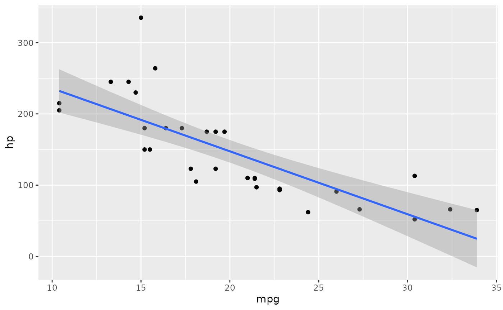
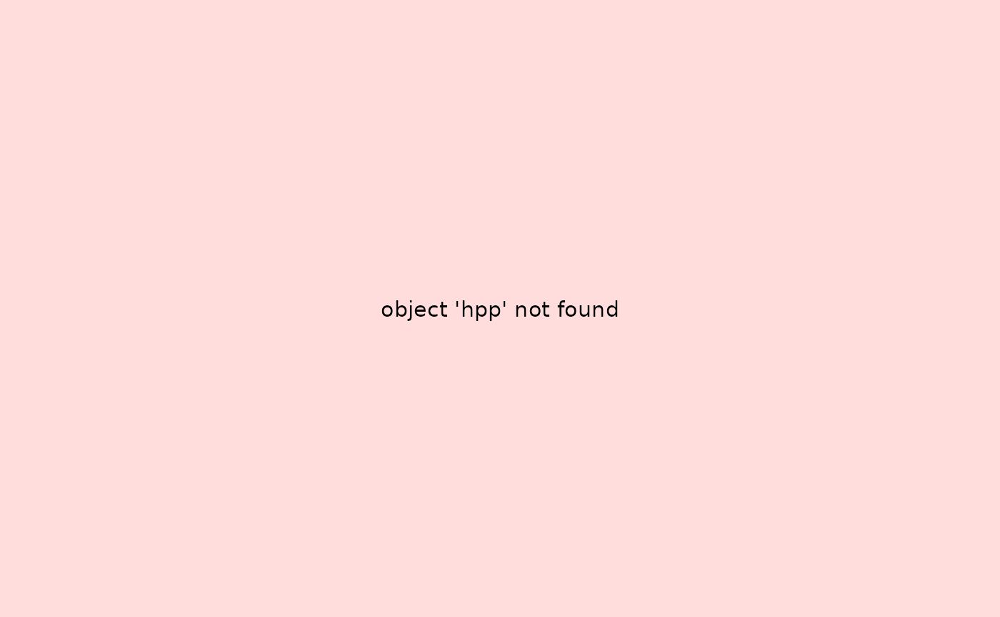
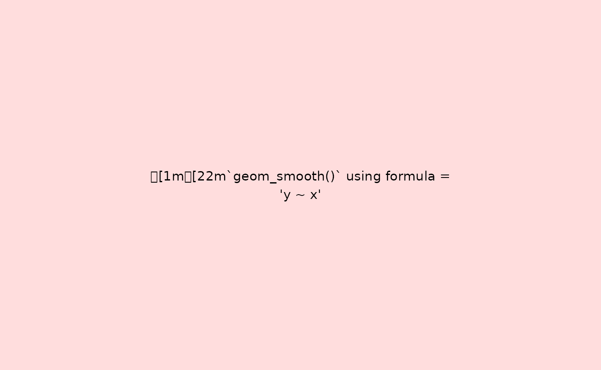

# Recording ggplot Objects with chronicler

## Introduction

Working with [ggplot2](https://ggplot2.tidyverse.org) can present a
unique challenge: **lazy evaluation**. An error in your plot code, like
a typo in a variable name, won’t stop execution when you define the
plot. The error only appears when you try to print or render it. This
can be especially frustrating when rendering a long R Markdown or Quarto
document, where a single broken plot can cause the entire process to
fail.

`{chronicler}` provides a solution with
[`record_ggplot()`](https://b-rodrigues.github.io/chronicler/reference/record_ggplot.md).
This function acts as a safety net, wrapping your entire ggplot
expression in a recorder that safely evaluates it. It captures not only
the final plot, but also all the errors, warnings, and messages that
occur during its construction.

This process results in two key benefits:

1.  **Crash-Proof Rendering**: If a plot fails,
    [`record_ggplot()`](https://b-rodrigues.github.io/chronicler/reference/record_ggplot.md)
    catches the error and produces a placeholder **error plot** that
    displays the error message. This allows your R Markdown documents to
    render completely, letting you fix the broken plot later.
2.  **Enhanced Debugging**: Every step is logged. You get a detailed,
    reproducible trace of the plot’s construction, making it much easier
    to diagnose issues.

This vignette demonstrates how to use
[`record_ggplot()`](https://b-rodrigues.github.io/chronicler/reference/record_ggplot.md)
to make your plotting workflows more robust and debuggable.

## Basic Recording and Inspection

Let’s start by recording a valid ggplot expression.
[`record_ggplot()`](https://b-rodrigues.github.io/chronicler/reference/record_ggplot.md)
captures the entire call, including all the layers.

``` r
r_plot <- record_ggplot(
  ggplot(mtcars, aes(x = mpg, y = hp)) +
    geom_point() +
  geom_smooth(method = "lm", formula = y~x)
)
```

The resulting `r_plot` object is a **chronicle**. When you print it, the
ggplot object is rendered as usual. Behind the scenes, however,
`{chronicler}` has logged the entire process.

To get the raw ggplot object back, you can use
[`unveil()`](https://b-rodrigues.github.io/chronicler/reference/unveil.md):

``` r
unveil(r_plot)
```



To see the detailed log, including any messages generated during
rendering (like the one from `geom_smooth`), use
[`read_log()`](https://b-rodrigues.github.io/chronicler/reference/read_log.md):

``` r
read_log(r_plot)
#> [1] "OK `ggplot(mtcars, aes(x = mpg, y = hp)) + geom_point() + geom_smooth(method = \"lm\", \n    formula = y ~ x)` at 12:42:27 (0.944s)"
#> [2] "Total: 0.944 secs"
```

## Handling Failures Gracefully

The real power of
[`record_ggplot()`](https://b-rodrigues.github.io/chronicler/reference/record_ggplot.md)
becomes apparent when something goes wrong.

#### Capturing Errors

Consider a common typo, where `hp` is misspelled as `hpp`. A standard
ggplot call would throw an error upon printing. With
[`record_ggplot()`](https://b-rodrigues.github.io/chronicler/reference/record_ggplot.md),
the error is caught and logged, and an informative error plot is
generated instead.

``` r
r_bad <- record_ggplot(
  ggplot(mtcars, aes(x = mpg, y = hpp)) +  # typo: 'hpp'
    geom_point()
)

# Printing the object shows the error plot, not a crash
r_bad
#> NOK! Value computed unsuccessfully:
#> ---------------
#> Just
```



    #> 
    #> ---------------
    #> This is an object of type `chronicle`.
    #> Retrieve the value of this object with unveil(.c, "value").
    #> To read the log of this object, call read_log(.c).

    # The log tells you exactly what went wrong
    read_log(r_bad)
    #> [1] "NOK `ggplot(mtcars, aes(x = mpg, y = hpp)) + geom_point()` at 12:42:29 (0.063s)"
    #> [2] "Total: 0.063 secs"

The R session continues without interruption, and you have a clear
record of the problem.

#### Controlling Strictness

Sometimes, you may want to treat messages or warnings as if they were
failures. The `strict` argument gives you this control. For example,
[`geom_smooth()`](https://ggplot2.tidyverse.org/reference/geom_smooth.html)
produces a message about the formula it’s using. By setting
`strict = 3`, we can tell `record_ggplot` to treat any message as a
critical event and generate an error plot.

``` r
r_plot_strict <- record_ggplot(
  ggplot(mtcars, aes(x = mpg, y = hp)) +
    geom_point() +
    geom_smooth(method = "lm"),
  strict = 3
)
```

Now, instead of the plot, we see the captured message displayed in the
error plot:

``` r
unveil(r_plot_strict)
```



## Conclusion

[`record_ggplot()`](https://b-rodrigues.github.io/chronicler/reference/record_ggplot.md)
provides a safe and traceable way to build ggplot objects. By wrapping
your plot code, it makes complex plots easier to debug and prevents
common errors from halting your analysis or document rendering. It
transforms plot creation from a potentially disruptive step into a
logged, reproducible, and robust part of your workflow.
